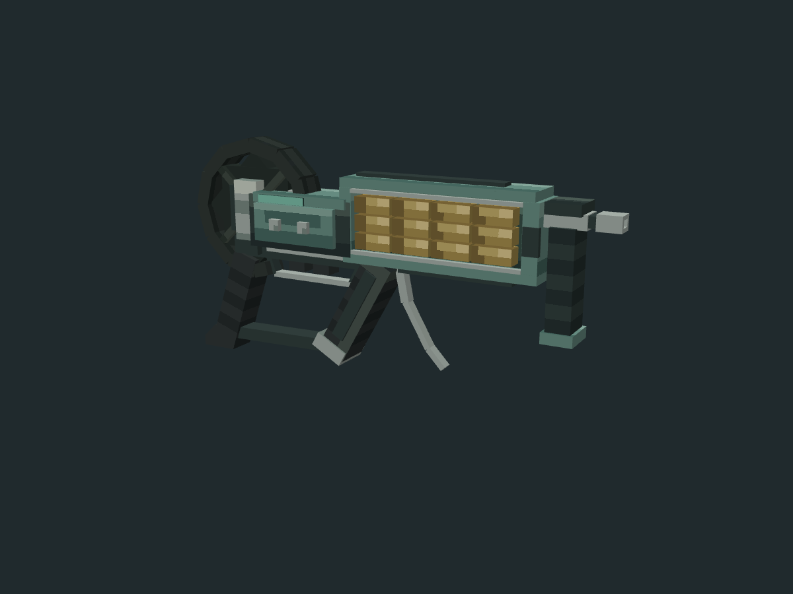

# 高级注射器枪 AdvancedSyringeGun — 最终人工调整版

制作来源：人工 + AI（TakaraMiyuki + GPT-6）。人工完成最终几何、UV 和像素贴图调整；AI 使用 Codex、Blockbench 5.2.2、Python / Pillow 完成初始模型和尾部圆环修订，并基于最终人工保存版本重出几何、预览和验证。

更新日期：2026-11-14。发布目标仍为 `art/models/advanced_syringe_gun_20261113/`，按用户要求覆盖该目录现有版本，更新 Discussion #39 已有候选 A，不另立候选。仅美术资产，尚待上游评审，未接入游戏。



## 本轮变更与保留

最终输入为用户本轮保存的 **82 cubes / 8 bones** 工程，包含尾部圆环、枪托、扳机等人工调整，以及修改过的 UV 和 **256×256** 像素贴图。本轮不重建或重新整圆用户最终几何；82 个元素的形状、变换、面 UV 和纹理引用逐字段保持一致，骨骼语义保持一致，内嵌 PNG 字节保持一致。

为便携交付，清除了贴图外部 `path` / `relative_path`，保留完整内嵌 PNG；清除了编辑器专用 `primary_selected` 标记。原始人工输入在 `reference/manual_publish_input.bbmodel`，清理后的最终输入在 `reference/manual_publish_portable.bbmodel`。这些清理不改变几何、骨骼变换或贴图像素。

相对首次上游版本：69 → **82 cubes**，8 bones 不变，声明面 414 → **492**，实际 PNG 从 64² 更新为人工保存的 **256²**。工程 UV 逻辑空间仍为 **64×64**，每一逻辑 UV 单位对应 4×4 PNG 像素；不得把 UV 当作 256 空间或缩小图片。正确映射后的所有面采样区域均不透明。

预算按当前人工输入复核：90 cubes / 540 faces / 单图集最大 256²，实际未超预算。单材质、单帧，无动画副本或额外透明覆盖；基础 RGBA 为 256 KiB，不是实测显存或 FPS。尾环多边形背衬和连接结构保留，本轮没有删减隐藏面。

## 比例和格式

编辑坐标枪口朝 +X，Y 向上，Z 为厚度；Bedrock codec 镜像 X，导出枪口朝 −X。最终原生包围盒：最小 `[-8.297979, 0.386984, -1.288]`，最大 `[8.56, 8.882976, 1.288]`；尺寸约 `16.857979 × 8.495992 × 2.576` 单位，即 **1.053624 × 0.531000 × 0.161 格**（16 单位 / 格）。

这是双手医疗工具的美术尺寸，不是原作现实尺寸。原作精灵 145×78，继承 scale=0.5 后为 72.5×39 游戏像素，不可直接换算现实米制长度。

## 原作与风格来源

- 简中：`Content/Texts/SimplifiedChinese/SimplifiedChineseVanilla.xml`，`entityname.advancedsyringegun=高级注射器枪`。
- 英文：`Content/Texts/English/EnglishVanilla.xml`，同条目 `Advanced Syringe Gun`。
- 实体：`Content/Items/Jobgear/Medic/medic_talent_items.xml`，`identifier=advancedsyringegun`，继承 `syringegun` 的 `scale=0.5`。
- 精灵：`Content/Items/JobGear/TalentGear.png`，`sourcerect=354,429,145,78`。裁切、用户参考及查证值位于 `reference/`。
- 风格沿用 curated 注射器枪 / 焊接工具的低多边形结构、金属和橡胶分层；未使用 deprecated 或复制外部模型贴图。尾部内部功能、厚度与背面由美术补全，不声明为官方三维结构。

## 文件和验证

- `advanced_syringe_gun.bbmodel`：可编辑 Bedrock Entity 工程，完整内嵌 PNG，无外部纹理依赖。
- `advanced_syringe_gun.geo.json`：Blockbench 原生导出，1.12.0，identifier `geometry.advanced_syringe_gun`。
- `advanced_syringe_gun_tex.png`：256×256 RGBA，无半透明像素；透明 RGB / alpha 均为 0。
- 六张 1200×900 `preview_*.png` 来自原生 Blockbench Preview / Three.js，纯色底，无 UI / 网格；正、背、侧、顶正交，两张斜视透视。
- `validation.json` / `reference/validate_manual_publish.py`：人工元素、骨骼语义和 PNG 保留、实际 UV 采样、透明、计数、预算和预览尺寸检查通过。
- `reference/native_reopen_validation.json`：关闭并重新打开后，元素、分组和 PNG 完全一致；原生重出 geo 与交付严格一致；纹理错误 0。
- `structure_audit.json`：generic 结构审计无错误 / 警告，无非正体积；不是完整 Bedrock schema 或客户端兼容认证。

`reference/true_circle_check.json`、旧基线和圆环修订报告为人工最终调整之前的历史证据，不覆盖当前人工造型。当前以本 README、validation、manual_publish_portable 和 native_reopen_validation 为准。

未测试 Minecraft 客户端、手持 / GUI / 掉落显示、射击、扫描、动画或 FPS。未修改游戏逻辑；本地 curated 分类及进入 main 均不代表上游评审通过。

## 重现

Python 3 + Pillow，从资产目录运行：

```text
python reference/build_revision.py
python reference/validate_manual_publish.py
```

构建优先恢复 `manual_publish_portable.bbmodel` 和内嵌 PNG，不重新生成最终人工几何。老的 round_input 与初始建模逻辑仅为历史记录。

原生导出 / 预览另需 websocket-client 和本机 Blockbench 调试端口 9225（独立 profile）：

```text
python reference/bb_native.py reference/load_native.js
python reference/bb_native.py reference/render_native.js
python reference/bb_native.py reference/verify_reopen.js
python reference/validate_manual_publish.py
```

脚本按自身位置解析路径，不依赖本机游戏目录；离屏 Preview 完成后释放，不使用 MCP 凭据或更改认证配置。
