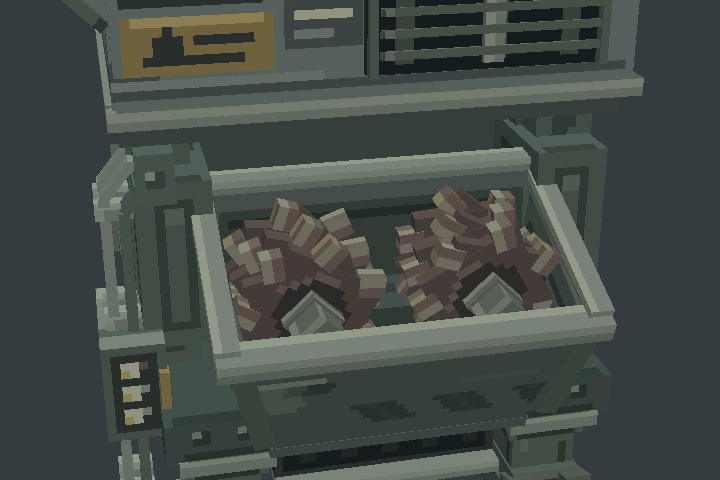

# 解构仪 Deconstructor · 双轴工作动画

制作来源：人工 + AI。用户完成最终外形与材质调整，Codex（GPT-6）用 Blockbench 5.2.2 制作双刀轴工作循环。**2026-11-15 16:09 用户再度手调**：料斗分组前倾 5°、整体位置与深度微调。本工程以该版为基线，并把模型整体沿 X 平移 −7，使其回到方块原点居中（`centerX = 0`，与仓库全部多格资产的惯例一致）。170 个方块、10 个分组。



## 使用

打开 [可编辑工程](deconstructor.bbmodel)，切到 Blockbench 的动画页，选择 `animation.deconstructor.work` 并播放。游戏侧可使用 [Bedrock 动画](deconstructor.animation.json)、[几何](deconstructor.geo.json) 和 [贴图](deconstructor_tex.png)。工作状态由游戏侧驱动，此次验证在编辑器内完成。

每根刀轴每秒一圈，1 秒回到起始姿态。正面朝 +Z，左刀轴顺时针、右刀轴逆时针。两组刀齿在中央向下卷入，每根轴的三片错齿刀盘随同一根骨骼转动。五个线性关键帧分别位于 0、0.25、0.5、0.75、1 秒，左轴绕 Z 从 0° 到 −360°，右轴从 0° 到 +360°。

## 来源与尺寸

原作中、英文名分别见简中和英文游戏文本的 `entityname.deconstructor`。游戏文件 `Content/Items/Fabricators/fabricators.xml` 的六片装饰刀盘分成转速符号相反的两组。可对照 [原作外壳](reference/game_housing.png) 和 [单片刀盘](reference/game_cutter.png)。

每格 16 个建模单位。最终手调工程在静止姿态实测宽 2.000 格、高 2.519 格、深 1.569 格，X 轴居中于方块原点（−16 … +16）。工程以 256 × 256 的逻辑 UV 映射 512 × 512 像素材质。本目录的外部 PNG 取自最终工程内嵌的图像。四张 1200 × 900 静态预览和 50 帧、1 秒的实速 GIF 均来自本轮工程的 Blockbench 视口。

## 检查结果

已重开工程，复核几何与动画的原生导出，并采样 49 个原生姿态，确认方向、角速度及其余分组的静止姿态（含料斗的 5° 静态前倾）。循环的起止画面逐像素相同。已检查正面和斜上方慢放，未进入 Minecraft 测试。

对旋转中的两个刀组每隔 1° 进行一次定向包围盒检测，已计入料斗分组的 5° 前倾（刀组为其子级，父级旋转一并参与变换）。两组刀盘的旋转外缘之间约有 0.61 个模型单位的间隙。部分角度刀组和同侧料斗侧板的几何有最多约 0.97 个单位的重叠，齿尖还会略微进入底板（约 0.66）和侧唇（约 0.29）。轴端与挡板有相交。上述数值为几何检测结果，详见 [验证记录](validation.json)。

## 本轮范围与上版差异

相对 2026-11-15 11:26 那版（即上游当前 `main` 中的 `deconstructor_20261115/`），本轮变化为：

| 项 | 上版 | 本轮 |
| --- | --- | --- |
| 料斗姿态 | 无分组旋转 | `feed_hopper` 静态前倾 5°（绕 X） |
| X 居中 | −16 … +16（`centerX = 0`） | 手调后曾偏到 −9 … +23（`centerX = 7`），已平移回 −16 … +16 |
| 深度（Z） | 1.613 格 | 1.569 格 |
| 几何 / 骨骼 / UV | 170 cubes / 10 bones | 未变 |
| 贴图 | — | 未变（字节一致） |
| 动画 | `animation.deconstructor.work` | 未变（导出逐字段一致） |

坐标居中是本轮唯一由 AI 执行、而非用户手调的改动：用户手调版外框为 −9 … +23、中心在 +7，会相对仓库所有存量多格资产偏出一侧。经确认按项目惯例归中，平移量 `dx = −7` 记入 `validation.json` 的 `recenter_dx` 字段，可用 `reference/recenter_x.py` 复现。

仅美术资产：未修改 `src/main/resources`，未注册方块，未启动 Minecraft 客户端。

## 复现

[旋转轨道脚本](reference/rotation.js) 使用 Blockbench 动画 API 在无动画的手调工程副本上添加工作循环。原生 Bedrock 动画导出包含两个同名骨骼的旋转轨道。[预览脚本](reference/render_previews.py) 可连接打开此动画工程的独立 Blockbench 本机调试端口，导出原生视图并构建循环 GIF。[验证脚本](reference/validate.py) 复核运动、源工程保真和几何间隙。[居中脚本](reference/recenter_x.py) 对工程整体做 X 平移。脚本使用 Pillow、NumPy 和 websocket-client。

用户 16:09 的手调原稿随交付入库为 [`reference/manual_handedit_20261115_1609.bbmodel`](reference/manual_handedit_20261115_1609.bbmodel)，`--source` 指向它并给出同样的 `--dx` 即可复现；`validation.json` 的 `source_sha256` 对应这份文件。

```text
python reference/recenter_x.py --dx -7
python reference/render_previews.py --port <端口>
python reference/validate.py --port <端口> --source reference/manual_handedit_20261115_1609.bbmodel --dx -7
```

三个脚本都要求 Blockbench 以 `--remote-debugging-port=<端口>` 启动（建议加独立 `--user-data-dir`，否则调试端口可能不监听），且已在其中打开本目录的 `deconstructor.bbmodel`。这一步需要交互式 Blockbench 会话，无法在纯命令行下自动完成。
