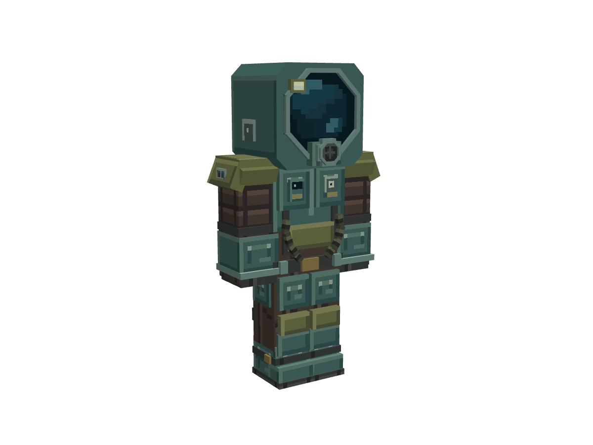

# 潜水服 DivingSuit

制作来源：人工 + AI（TakaraMiyuki + GPT-6.1 Sol / Codex）。AI 完成初始几何与贴图；人工微调模型和像素贴图；AI 基于人工保存版本重新导出几何、生成预览并执行交付检查。工具：Blockbench 5.2.2 / MCP 1.10.1。2026-11-12。

用途：按 Minecraft 标准 Steve 玩家体型制作的低多边形护甲美术资产。头、身体、双臂、双腿、双靴分别绑定。当前交付包含可编辑模型、Bedrock 几何、贴图及预览；**尚未注册成游戏内可装备物品**。



## 打开与文件

- `diving_suit.bbmodel`：在 Blockbench 打开即可继续编辑，内嵌贴图，无绝对路径依赖。
- `diving_suit.geo.json`：由 Blockbench 的 Bedrock 编码器实际导出，`format_version: 1.12.0`，`geometry.diving_suit`。
- `diving_suit_tex.png`：256×256 RGBA，单材质，硬边像素，无随机噪点、渐变或半透明像素。
- `preview_front.png`、`preview_back.png`、`preview_side.png`、`preview_oblique.png`：1200×900，透明背景，无网格、无 UI。前三张正交，斜视透视。
- `validation.json`、`structure_audit.json`：交付审计及其覆盖范围。
- `reference/`：参考裁切、原图、配色、设计数据、可重跑脚本、检查证据。

## 造型与原作查证

主要识别特征：深蓝黑面罩、八边形金属面框、正面圆形呼吸阀、头灯、灰青色防护壳、黄绿色肩甲、棕灰色分节内衬、胸前表盘及氧气状态窗、腹部双软管、厚底靴。面罩采用不透明深色玻璃的像素表现，有意遮住玩家脸部。

用户提供的正面头像及穿着侧面图保存在 `reference/user_front.png` 和 `reference/user_side.png`。背面缺少清晰参考，背后的单供氧罐、检修盒和束带为配合原作工业风格作出的自由设计，不称为原作背面复刻。

中英名称分别查证游戏本地文本：

| 项目 | 文件与条目 | 查证值 |
|---|---|---|
| 简体中文 | `Content/Texts/SimplifiedChinese/SimplifiedChineseVanilla.xml`，`entityname.divingsuit` | 潜水服 |
| 英文 | `Content/Texts/English/EnglishVanilla.xml`，`entityname.divingsuit` | Diving Suit |
| 实体 | `Content/Items/Diving/divinggear.xml`，`identifier="divingsuit"` | item scale 0.5 |
| 穿戴头盔图 | `Content/Items/Jobgear/headgears.png` | sourcerect 5,4,92,94；scale 0.65 |
| 身体穿戴图 | `Content/Items/Diving/reg_DivingSuit.png` | 继承人体肢体的矩形与缩放 |
| 库存图标 | `Content/Items/InventoryIconAtlas2.png` | sourcerect 0,256,128,128 |

完整摘录见 `reference/official_source.json`。官方图仅用于观察，不作为模型贴图使用。另查阅了[官方维基 Diving Suit](https://barotraumagame.com/wiki/Diving_Suit)确认题材与装备特征；未把游戏的压力数值等功能制作进模型。

项目风格参考只取自 `art-vault/curated/`：`engine_20261111_v2` 的低对比度金属色块，以及 `plasma_cutter_20261110` 的功能分区、像素亮边与材质对比。实际检查了两件成品的工程几何、贴图尺寸和 UV。没有使用 deprecated 资产，也没有复制参考模型的几何或贴图。

## 尺寸依据与骨骼

以标准 Steve 的头 8×8×8、身体 8×12×4、手臂 4×12×4、腿 4×12×4 个模型单位为起点；脚底为 Y=0，头顶为 Y=32，16 个单位按 1 格换算。护甲在玩家表面外保留包覆余量，头盔、肩甲、呼吸阀、供氧组件与鞋尖额外外扩。未把原作二维图集的像素尺寸或 item scale 直接换算成人体米数。

- 最终外包围盒，Blockbench 坐标：X **-9.359532～9.359532**；Y **-0.075～33.85**；Z **-6.43～5.8**。
- 总外形：约 **18.7191 × 33.925 × 12.23** 模型单位，即 **1.170 × 2.120 × 0.764 格**。这是美术外包围盒，不是玩家碰撞箱。
- 正面朝向 Blockbench 的 **-Z**。Bedrock 编码器对 X 坐标及旋转按自身约定转换，请勿再次手动镜像导出文件。

| 骨骼 | Blockbench 轴心 | 建议装备槽 |
|---|---|---|
| armorHead | 0,24,0 | 头盔 |
| armorBody | 0,24,0 | 胸甲 |
| armorRightArm / armorLeftArm | -5,22,0 / 5,22,0 | 胸甲 |
| armorRightLeg / armorLeftLeg | -2,12,0 / 2,12,0 | 护腿 |
| armorRightBoot / armorLeftBoot | -2,12,0 / 2,12,0 | 靴子 |

八个骨骼均为独立根骨骼；靴子与对应腿共用髋部轴心，以便随同一条腿运动。手套随手臂、腹部软管与供氧组件随身体、面罩与呼吸阀随头部。没有额外的肘膝动画，也没有在工程内保存行走动画副本。

骨骼命名为后续 GeckoLib 护甲渲染准备；目标项目为 Java 1.20.1 Forge。当前 Blockbench 窗口未安装 GeckoLib 格式插件，因此使用项目规范规定的 Bedrock Entity 编辑与导出。接入时仍需按[GeckoLib 护甲文档](https://github.com/bernie-g/geckolib/wiki/Geckolib-Armor-%28Geckolib4%29)配置物品、槽位可见性和渲染器，并在游戏中检查轴心。此文件不是原版 Java 资源包即可启用的三维护甲。

## 成本、清理与验证

| 检查 | 实际结果 |
|---|---|
| 编辑 / 导出几何 | 104 / 104 cubes，0 meshes，8 bones |
| 声明面数 | 610 quads；按每面两三角形计算，上限 1220 triangles |
| 项目预算 | 140 cubes / 840 faces / 1 张 256² 贴图，全部在预算内 |
| 贴图 | 1 张，65536 像素，1 帧；基础 RGBA 262144 字节，不等于显存实测 |
| 工程重开 | Blockbench 中重开成功，104 cubes / 1 texture 保持 |
| 实际导出 | 重开后再导出的 JSON 与交付 JSON 内容相等 |
| UV | 全部在图集范围内；所有使用区域不透明；外部 PNG 与内嵌纹理像素一致 |
| 身体包覆 | 标准 Steve 六部分表面按 0.25 单位采样，共 26124 点，无未包覆采样点 |
| 姿态查看 | 初版曾做转头、摆臂、迈步临时检查；当前手改版未重复动态检查 |
| 恢复 | 临时姿态已归零，交付为默认站姿 |
| 游戏内 | 未测试、未接入；未测量 FPS 或实际材质批次 |

清理了 **14 个明确遮挡的面**，包括面罩背面/侧边、帽壳内部接缝、头灯后面、氧气罐束带前面及被鞋底遮住的靴底。修正了腕口、肘圈和背部歧管的共面重叠。没有重复整套几何，没有逐帧复制，也没有独立的发光壳。八边形帽壳与呼吸阀的局部交叠用来组成连续外轮廓，予以保留；不宣称所有内部面都已穷尽剔除。

`structure_audit.json` 为 generic cuboid 有限结构审计，未发现错误或警告；不等于完整 Bedrock/GeckoLib 兼容性认证。`bedrock_animation_mode` 为编辑器标准字段，本工程没有自定义动画轨道。

身体采样只检查默认姿态的覆盖，不证明所有动作都无穿模。厚肩甲与颈部存在常规护甲交叠；极端挥臂、潜泳、蹲伏、其他动画模组和 Alex 细臂仍需接入后测试。头灯目前是视觉细节，不附带动态光源、氧气或压力防护逻辑。

这是该资产首次入库，保留了人工最终修改。制作阶段曾修正手臂/腿部余量、增加呼吸阀边框、调整仪表像素密度，并处理共面闪烁。

## 本轮手改版本与预览重现

本轮以人工保存的模型和贴图为唯一输入，保留氧气状态面板、腹板、腹部软管、腕圈及膝部密封圈等手改，并保留面罩等区域的像素调整。104 cubes / 8 bones / 610 faces 保持；没有运行初始生成脚本覆盖手改。

四向预览已从当前工程重新生成，均为 1200×900；几何也已通过原生 Bedrock 编码器重出。当前版本通过重开、再导出一致性、UV、贴图一致性和身体表面采样检查。初版的姿态截图属于历史证据，不随本次发布；当前版本未重新进行游戏内或动态姿态验收。

Python 3 + Pillow 可执行离线校验。先在 Blockbench 打开本目录的 bbmodel 并启用 MCP，再从仓库根执行：

```text
python art/models/diving_suit_20261112/reference/render_asset.py --url http://127.0.0.1:3015/bb-mcp
python art/models/diving_suit_20261112/reference/validate_delivery.py
```

按本机实际设置替换端口。预览由 Blockbench 原生离屏相机生成，不是自建渲染器；参数见 `reference/final_capture.json`。脚本先核对打开工程的导出与交付几何一致，不重建模型或贴图。`bb_client.py` 为随附的本机 loopback MCP 连接器，无认证信息。

本资产按用户明确要求直推 main；目标目录 `art/models/diving_suit_20261112/`。仅交付美术资产，游戏端接入由后续集成负责。
