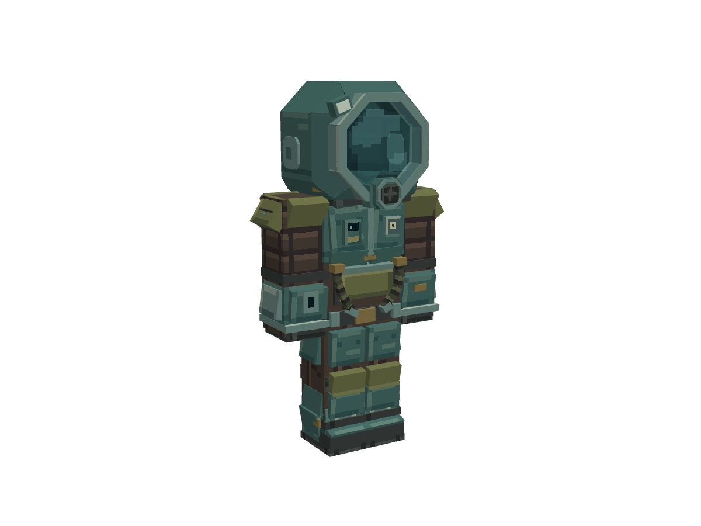

# 潜水服 DivingSuit v2（半透明面罩，最终 r4）

制作来源：**人工 + AI（TakaraMiyuki + GPT-6 / Codex）**。人工选择参考、微调 v1 模型与贴图，并逐轮反馈、验收 v2；AI 保留人工基线，完成 v2 结构扩展、像素纹理与 UV、中空头盔、半透明面罩、封角修正及交付检查。工具：Blockbench 5.2.2 / MCP 1.10.1。日期：2026-11-12。

按标准 Steve 玩家比例制作的低多边形护甲美术资产。采用分面压力头盔、八边形面框、独立半透明玻璃、呼吸器、拱形肩甲、胸前仪表、腹部双软管、背部供氧罐、分节护肢与厚底靴。此目录只交付美术资源，**尚未注册成游戏内可装备物品，未做客户端测试**。



## 文件与查看

- `diving_suit_v2_glass_r4.bbmodel`：可编辑工程，贴图内嵌，无绝对纹理路径依赖。
- `diving_suit_v2_glass_r4.geo.json`：Blockbench 原生 Bedrock 导出，格式 `1.12.0`，identifier=`geometry.diving_suit_v2_glass_r4`。
- `diving_suit_v2_glass_r4_tex.png`：单张 256×256 RGBA 像素图集。
- 根四向预览：1200×900，透明底、无网格和 UI；正/背/侧正交、斜视透视。
- `reference/worn/`、`reference/turn/`：自绘示例头部的佩戴与转头 35° 近照。
- `reference/empty/preview_rear_oblique.png`、`preview_upper_back.png`、`preview_lower_back.png`：头壳轮廓及上下封角检查。
- `reference/aperture/`：临时隐藏玻璃，检查八边形内部开口，**不是最终材质效果**。
- `validation.json`、`structure_audit.json`、`checksums.sha256`：检查结果、结构审计与全部发布文件校验值。

示例头部位于 `_preview_player_head_DO_NOT_EXPORT`，默认隐藏，分组与体块均不导出；不是要渲染到真实玩家上的假脸。需要查看佩戴效果时，可在大纲显示该组及子体块。

## 造型、材质与原作依据

保留灰青金属壳、橄榄肩甲、棕灰内衬和青蓝玻璃的材质区分。面罩可透视真实玩家脸部；基础 alpha=100，约 39% 不透明度，反光 128 / 155，深色边层 145。玻璃只有一张主要可见面，没有多层透明片叠加。

头盔为中空围壳。四块前侧斜壁的可见内缘裁成八边形开口，避免在面罩后形成方形小窗。上角封面与原倒角贴合，底部封面沿相邻斜壁交线收口；厚度向内，不使用外鼓尖角给头部留空间。颈部暗色密封圈覆盖标准玩家下颌下缘。

所有几何仍为原生 cuboids。头壳的部分开口与三角封面使用**二值 alpha 裁形**，不是任意三角网格或实体布尔运算；没有负尺寸。背部供氧罐、服务盒、护轨等为原作工业风格下的三维补完，不称为原作背面精确复刻。

中英文名称分别查证：

| 内容 | 原作文件与条目 | 查证值 |
| --- | --- | --- |
| 简体中文 | `Content/Texts/SimplifiedChinese/SimplifiedChineseVanilla.xml`，`entityname.divingsuit` | 潜水服 |
| 英文 | `Content/Texts/English/EnglishVanilla.xml`，`entityname.divingsuit` | Diving Suit |
| 实体 | `Content/Items/Diving/divinggear.xml`，`identifier=divingsuit` | item scale 0.5 |
| 头盔穿戴图 | `Content/Items/Jobgear/headgears.png` | sourcerect 5,4,92,94；scale 0.65 |
| 库存图标 | `Content/Items/InventoryIconAtlas2.png` | sourcerect 0,256,128,128 |

完整事实记录见 `reference/official_source.json`，裁切和用户参考图随附。官方图仅用于观察，没有作为本模型贴图。风格沿用本次制作时对 curated 成品中低对比金属色块、功能分区和像素材质对比的观察，没有参考 deprecated 资产。

## 比例与骨骼

以 Steve 的头 8×8×8、身体 8×12×4、手臂与腿 4×12×4 为身体框架；脚底 Y=0、玩家头顶 Y=32，16 单位按 1 格换算。没有把原作二维图集像素或 item scale 直接当作米数。

| 骨骼 | Blockbench 轴心 | 建议槽位 |
| --- | --- | --- |
| armorHead | 0,24,0 | 头盔 |
| helmetVisor，parent=armorHead | 0,24,0 | 头盔玻璃 |
| armorBody | 0,24,0 | 胸甲 |
| armorRightArm / armorLeftArm | -5,22,0 / 5,22,0 | 胸甲 |
| armorRightLeg / armorLeftLeg | -2,12,0 / 2,12,0 | 护腿 |
| armorRightBoot / armorLeftBoot | -2,12,0 / 2,12,0 | 靴子 |

靴子跟随腿的髋部轴心；没有新增肘膝骨骼或整套动画副本。正面朝 -Z；Bedrock 编码器按格式约定转换，不要再手动镜像。

包围盒 min=[-9.500716,-0.075,-6.92]，max=[9.500716,34.55,6.28]。外形 19.001432×34.625×13.2 单位，约 **1.188×2.164×0.825 格**；这是美术外形，不是玩家碰撞箱。

## 运行时接入要求

目标为 Minecraft Java 1.20.1 Forge / GeckoLib 风格护甲绑定。Bedrock 几何不等于已经接入，也不是仅靠原版 Java 资源包就能装备的护甲。

1. 保留真实玩家的 `head`；示例头部不进入游戏。
2. 壳体与内衬使用支持二值透明的 **cutout no-cull**。编辑器贴图已设双面；Java 渲染器仍需单独配置。
3. 先画玩家和壳体，再用支持纹理 alpha 的 translucent 通道只画 `helmetVisor`；壳体通道排除该骨骼，避免重复绘制。
4. 核对玻璃的深度写入、排序、槽位可见性与皮肤第二层。第一人称表现需要单独设计和实测。

`material_manifest.json` 只是集成说明，不会自动启用 Java 渲染行为。没有实现供氧、压力防护、动态头灯或装备逻辑。

## 成本与检查

| 项目 | 结果 |
| --- | --- |
| 编辑工程 | 218 cubes / 10 groups，含隐藏示例头部 1 cube / 1 group |
| 实际导出 | 217 cubes / 9 bones / 0 meshes |
| 声明几何 | 1198 quads，三角形上限 2396 |
| 图集 | 1 张 256²、1 帧；804 个半透明像素，仅在玻璃区域 |
| 封角 | 16 片贴合薄封面，内外面用于中空内衬；不扩大三角片 |
| 制作预算 | 220 导出体块、9 bones、1250 quads、1 张 256²图集以内 |

制作阶段已经在 Blockbench 重开并实际再导出，几何与交付文件一致。发布时核对主工程、几何、贴图和四向原生预览与已验收 r4 **逐字节相同**；因此沿用对应预览，没有把新截图冒充旧工程的结果，绑定记录见 `release_manifest.json`。

检查覆盖实际不透明封面，而非只看总体包围盒：读取原生世界顶点与 UV，取每个不透明像素完整方格的凸包，检查其处于相邻斜壁和头壳约束内；全部外侧封面位于指定支撑平面，厚度向内。还验证未修改体块、骨骼、玻璃像素、UV、透明 RGB、颈部收口、隐藏参考排除、原生重开一致性和预览状态恢复。

结构审计无错误，保留的 `translucency_review` 提醒要求核对目标渲染通道与排序。未启动 Minecraft、未测游戏内 FPS / draw calls；检查不证明所有动画模组、极端姿态或皮肤第二层均无穿模。

## 复核与重新出图

依赖 Python 3.10+ 与 Pillow。在仓库根运行离线检查：

```text
python art/models/diving_suit_v2_glass_r4_20261112/reference/validate_asset.py
```

在 Blockbench 打开主工程、启用本地 MCP 后，重新生成原生预览：

```text
python art/models/diving_suit_v2_glass_r4_20261112/reference/render_preview.py render --url http://127.0.0.1:3015/bb-mcp
python art/models/diving_suit_v2_glass_r4_20261112/reference/snapshot_faces.py
python art/models/diving_suit_v2_glass_r4_20261112/reference/validate_asset.py
```

预览脚本先核对打开工程和磁盘几何、贴图一致，再使用 Blockbench 原生离屏视图；临时材质分别绘制壳体和玻璃，结束后恢复。参数记录在 `reference/capture.json`。接口只接受无认证的本机 loopback，端口按本机 MCP 设置调整。

`reference/baseline_live.bbmodel`、`before_cap_faces.json` 是严格对照所需的历史证据，不是另一份当前资产；`cap_spec.json`、`neck_seal_spec.json` 给出本版明确结构参数。依赖特定活动工程 UUID 的一次性重建、调试和源快照脚本不入库；其作用是制作过程中的编辑器建模和保留现场。发布预览所需脚本、当前原生顶点记录和离线检查依赖均随附，可以从本目录复核。

校验清单记录的是发布时的文件字节。修改或重新出图后，应重新检查并更新 `checksums.sha256`，不要把旧校验结果用于新编辑。
