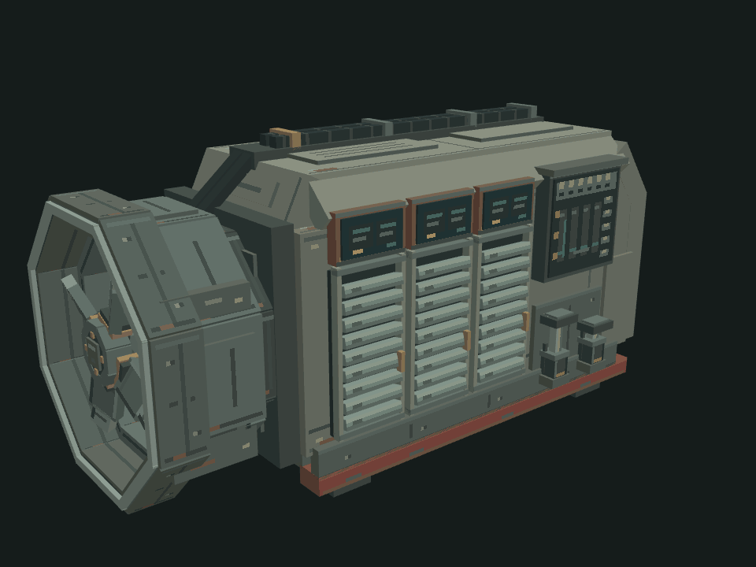

# 引擎 Engine｜实体检修板、双活塞与三条动画

引擎 Engine。制作来源、贡献者与分工见 [验证记录 `validation.json`](validation.json)；实物规格、文件摘要与三项验收证据同在该记录，本文不重复抄写。



## 来历与基线

本版**替换**了此前的候选 C `engine_20261113`（本次删除），两者是同一支线的先后手改稿。用户于 2026-11-15 保存候选 C 的手改版后，在其上补实体检修板、把转子改为四叶并新增双活塞机构，最终删除此前新增的 76 组螺钉与垫片。候选 C 的原工程未随目录复制，但手改入口与各轮冻结快照都在 `reference/`（`user_baseline.bbmodel` 为手改前基线，`animation_playback_fix_20261115/baseline_engine.*` 为最终冻结输入），可按[复现方式](#复现方式)重跑比对。

仓库中另有候选 A 扁平 [`../engine.*`](../engine.geo.json)（3.00 格宽，当前 `src/main/resources` 运行时几何）与候选 B [`../engine_20261111_v2/`](../engine_20261111_v2/README.md)（5.54 格宽）。本版取代候选 C 后与 A、B 并存待评选，不宣称已定案。

## 设计说明

正面 +Z、推进罩朝 -X、Y=0 贴地。保留候选 C 的三联百叶、仪表组、仪电控区、开放八边形推进罩与侧置设备舱；本轮新增背板四片带传动轴孔的电机结构、17 组实体检修板（20 个 cube），并把静态四叶转子接到可转动的 `rotor` 骨骼上。双活塞分列机身两侧，各由固定缸体与往复活塞头组成。

三条动画是**同一批运动轨道的三种演示粒度**，不要叠加播放：进入动画模式默认选中组合动画 `animation.engine.running`（2.4 s，转子三圈 + 活塞两个周期）；`animation.engine.rotor_spin`（0.8 s 一圈，75 RPM）与 `animation.engine.pistons`（1.2 s 一个周期，双活塞 180° 反相，总行程 3 BB）分别只演示单一机构。

内部推进罩、背部维护布局、双活塞与检修板属美术推定，不宣称原作存在对应的具体三维机构。活塞与转子的游戏侧驱动逻辑由集成者处理，本交付不含控制器。

## 尺寸依据

原作 `Content/Items/Engine/engine.xml` 的 `Scale="0.5"`，主图 `Engines.png` 裁切 `0,0,659,317`。按人物 120 px 对应 32 BB 假设，`K = 0.5 × 32 / 120`，得约 5.4 格宽的量级——**这是比例假设，不是官方米制尺寸**。当前边界与格数见 `validation.json` 的原生测量；尺寸以用户手动微调后的工程为准，本轮未重新缩放。

## 文件

- `engine.bbmodel`：可编辑 Bedrock Entity，内嵌 PNG 与三条动画。
- `engine.geo.json`：原生 Bedrock 1.12.0，`geometry.engine`。
- `engine.animation.json`：原生 Bedrock 1.8.0，三条 clip。
- `engine_tex.png`：RGBA 像素贴图。逻辑 UV 与图像尺寸的比例关系按用户设置保留。
- `preview_{front,back,side,oblique}.png`：1200×900；前三者正交、斜视透视，透明底、无网格无 UI。
- `preview_{running,rotor,pistons}.gif`：按最终工程重出的原生动画预览，Pillow 仅做 GIF 编码。
- `structure_audit.json`：本轮删除修订的结构审计原始证据。
- `reference/`：手改基线、各轮冻结快照、删除 UUID 清单、来源报告、调色板与脚本。

四视图与三条动图均由 Blockbench 自身 WebGL 渲染（`Canvas.withoutGizmos` 排除辅助线），不是另写的渲染器。额外的右侧、顶视、底视与近景在 `reference/physical_panels_20261115/preview_{right,top,bottom,detail}.png`。

## 来源与保留特征

标准引擎标识 `engine`；简中与英文条目分别查证（见 `validation.json.sources`）。原作裁切与来源摘要保存在 `reference/source_report.json`、`reference/original_engine_crop.png`。

## 交付边界

已在 Blockbench 5.2.2 重新打开工程、原生重出几何与动画并与仓库文件比对一致，四向预览逐张核对；详见 `validation.json` 的三项验收。**未进入 Minecraft 验证**：未验证游戏渲染、GeckoLib 控制器、碰撞、交互、放置方向与运行时性能，也未改 `src/main/resources`。

## 复现方式

需要 Python 3 / Pillow 与已启用 MCP 的 Blockbench（脚本默认连本机 `3005` 端口）：

```text
python reference/bb_work.py load
python reference/bb_work.py eval reference/texture_detail_pass_20261115/export_only.js
python reference/render_previews.py
python reference/render_motion.py
python reference/physical_panels_20261115/render_extra_checks.py
python reference/physical_panels_20261115/render_closeup.py
python reference/bb_work.py load
python reference/bb_work.py eval reference/native_roundtrip.js
python reference/bb_work.py eval reference/animation_playback_fix_20261115/verify_playback.js
python reference/animation_playback_fix_20261115/validate_metadata_fix.py
```

以上从当前工程刷新导出并复查。`reference/remove_screws_20261115/validate_removal.py` 针对纯删除版本，不作为当前元数据修正版入口。`reference/physical_panels_20261115/build_physical_panels.py` 会重新生成已删除的螺钉，不是当前版本入口；其它旧生成与验收脚本仅作历史溯源。

三条动画的默认选择标记、列表顺序与保存路径由 `reference/animation_playback_fix_20261115/validate_metadata_fix.py` 校验；运动轨道与关键帧在本轮未改。
