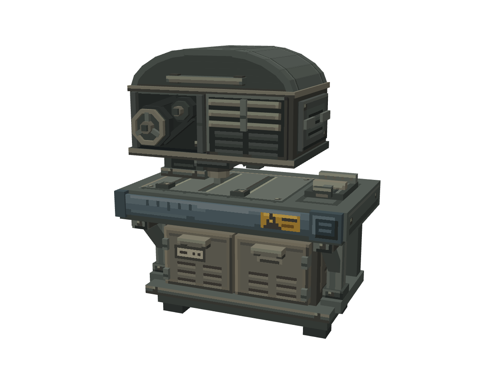

# 加工台 Fabricator · 候选 B

**制作来源：人工 + AI（TakaraMiyuki + GPT-6 / Codex，Blockbench 5.2.2）。** Codex 制作初始几何和像素材质；TakaraMiyuki 手动调整最终工程和贴图。本次直接从人工保存的工程导出。工程与外置 PNG 已分别比对 SHA-256，工程内嵌纹理与外置 PNG 逐字节一致。

## 造型与比例

原作名称来自 Barotrauma 安装目录的 `Content/Texts/SimplifiedChinese/SimplifiedChineseVanilla.xml` 和 `Content/Texts/English/EnglishVanilla.xml`，两处条目均为 `entityname.fabricator`。设备定义在 `Content/Items/Fabricators/fabricators.xml`，标识为 `fabricator`，绘制比例为 0.5。完好状态主精灵取自同目录 `FabricatorsAndDeconstructors.png` 的 `0,624,336,400` 区域，机头另有装饰层。原作裁切及组合参考图位于 `reference/`。

以原图宽高比和约 2.5 格的目标宽度起稿，高度约为 2.5 × 400 / 336 ≈ 2.98 格。手调后外轮廓含机头两侧的检修盖。实际宽、高、深为 **2.5625 × 2.96875 × 1.571875 格**（16 BB 单位/格）。正面朝 +Z，底面 Y=0。机头轮系、夹头和带夹具的台面分别建模，台面由斜撑和立柱承托，双门柜向内退进。进深和侧背检修结构为立体化设计。本候选和 2026-11-14 的候选 A 各自使用独立目录。

## 打开与复核

- `fabricator.bbmodel` 是可编辑工程；`fabricator.geo.json` 为 Bedrock 1.12.0 原生几何，标识为 `geometry.fabricator`。151 个方块、9 个骨骼、906 个面。
- `fabricator_tex.png` 为 512 × 512 RGBA。工程和几何共同采用 256 × 256 的逻辑 UV 空间，每一逻辑单位覆盖 2 × 2 个实际像素。结构预检的唯一警告 `texture_export_size_mismatch` 对应这一设置。逐面核对了 UV 端点、纹理引用及映射区域的像素；结果见 `validation.json` 和 `structure_audit.json`。
- `preview_front.png`、`preview_back.png`、`preview_side.png` 为正交视图，`preview_oblique.png` 为透视视图。四张图均为 1200 × 900 透明底，来自当前工程的 Blockbench 场景。
- 可在副本中使用独立用户目录启动 Blockbench 5.2.2 并指定本机调试端口，例如 19479。安装 Python 的 `websocket-client` 后运行 `python reference/blockbench_views.py --port 19479`，可从工程重出几何、四视图和 `reference/native_check.json`。该脚本会更新这些导出文件。

已在 Blockbench 重新打开工程，并对 Bedrock 几何进行导入和再次导出，两次几何内容一致。未进入 Minecraft 验证。
