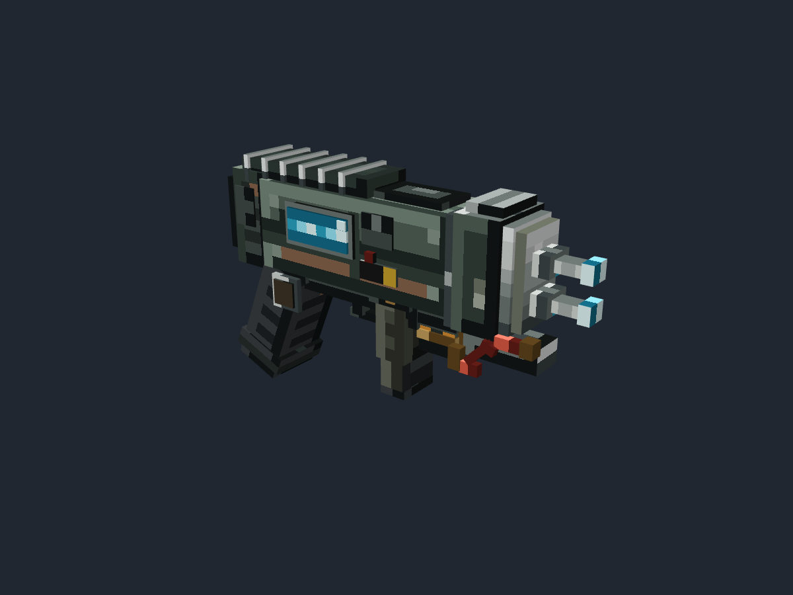

# 潜渊症等离子切割器 PlasmaCutter · Minecraft Java 3D 物品模型

- 日期：2026-11-10
- 目标：Minecraft Java Edition 1.20.1 Forge
- 制作来源：人工 + AI。AI 完成基础几何、像素贴图、预览和验证；人工完成最终枪管位置、长度、软管和燃料舱细节调整。
- 范围：仅美术资产。未修改 Mod 的 `src/main/resources`，未注册物品，未启动 Minecraft 客户端。



## 设计结果

保留并重排了潜渊症等离子切割器的主要识别点：

- 粗壮的去饱和绿灰机体和黑色后握把；
- 顶部六根银色散热/护条；
- 侧面的亮青色状态屏、压力表、通风片、红色按钮和黄色警示板；
- 前端上下排列的双钢制切割枪管与青色尖端，最终版进一步缩短枪管前伸长度；
- 切割头下方四段式红色管线与黄铜接头；
- 前握把后移约 1.1 单位，为燃料罐留出明确安装空间；
- 下方新增可见燃料罐、黄铜箍环、燃料接口与状态窗；
- 前握把、扳机与扳机护圈，形成可读的工具/武器混合轮廓。

人工定稿进一步上移下枪管、缩短两根枪管、延长中段软管，并移除燃料窗上的小凸块，使前段轮廓更紧凑。参考图只展示一个侧面，因此背面维护板、顶面护条、双枪管厚度与另一侧结构属于合理推断，不声称逐像素还原原作。

## 交付内容

| 文件 | 说明 |
| --- | --- |
| `plasma_cutter.bbmodel` | 可编辑 Blockbench Java Block/Item 工程，内嵌两张贴图 |
| `plasma_cutter_3d.png` | 64×64 基础像素图集 |
| `plasma_cutter_emissive.png` | 64×64 发光遮罩，只有屏幕和切割尖端为不透明青色 |
| `assets/barotrauma/models/item/plasma_cutter_3d.json` | 干净的 Java 1.20.1 物品模型 |
| `assets/barotrauma/textures/item/plasma_cutter_3d.png` | 运行时基础贴图 |
| `assets/barotrauma/textures/item/plasma_cutter_emissive.png` | 预留 emissive 材质贴图 |
| `preview_front/back/side/top/oblique.png` | 5 张本体视图 |
| `preview_display_*.png` | 7 张 Display 槽位预览 |
| `audit_bbmodel.json`、`audit_model.json`、`audit_cost.json` | 结构、导出与预算审计 |
| `validation.json` | 源工程与 Java 导出逐项一致性报告 |
| `reference/` | 用户参考图、调色板、成本计划与预览复现脚本 |

## Java 资源接口

```text
模型：barotrauma:item/plasma_cutter_3d
基础贴图：barotrauma:item/plasma_cutter_3d
发光槽：barotrauma:item/plasma_cutter_emissive
父模型：minecraft:item/handheld
```

模型坐标固定为切割头朝 `+X`、主展示面朝 `+Z`，Z=8 为中心线。包围盒为 `0.25..16.45 × 2.50..12.13 × 6.55..9.72`，尺寸约 `16.20 × 9.63 × 3.17` 模型单位。

## 规格与成本

编辑工程：

- 53 个立方体、318 个声明面；
- 7 个组（1 个根组 + `receiver / grips / mechanism / emitter / conduits / emissive`）；
- 4 个旋转立方体：后握把、后握把底、`hose_2`、`hose_3`；
- 无零厚度 plane、无负尺寸描边壳、无骨骼、无动画；
- 2 张 64×64 单帧贴图；
- 129 个实际使用的 UV 岛，使用 1842 个有效像素，覆盖率约 45.0%，统一 2 px/模型单位；
- 294 个面使用基础贴图，24 个面使用 emissive 材质槽。

预算：54 组件、330 面、8192 纹理像素。实际均未超预算。

## Display 参数

| 槽位 | rotation | translation | scale |
| --- | --- | --- | --- |
| thirdperson_righthand | `[0, 90, 40]` | `[0, 5, 0.25]` | `[0.85, 0.85, 0.85]` |
| thirdperson_lefthand | `[0, -90, -40]` | `[0, 5, 0.25]` | `[0.85, 0.85, 0.85]` |
| firstperson_righthand | `[5, 95, 0]` | `[0.84, 2.99, -0.89]` | `[0.68, 0.68, 0.68]` |
| firstperson_lefthand | `[5, -95, 0]` | `[0.84, 2.99, -0.89]` | `[0.68, 0.68, 0.68]` |
| gui | `[15, -30, 0]` | `[0, 0, 0]` | `[0.8, 0.8, 0.8]` |
| ground | `[0, 0, 0]` | `[0, 2, 0]` | `[0.5, 0.5, 0.5]` |
| fixed | `[0, -180, 0]` | `[0, 0, 0]` | `[1, 1, 1]` |

三视角预览显示握把位于拳心附近、切割头朝前下方，机体顶面朝上。实际游戏内姿态仍需客户端确认。

## 发光说明

Java 1.20.1 原版物品模型不支持真正的 emissive/bloom。当前交付将蓝色屏幕和两个切割尖端单独分配到 `#1` 材质槽，并附完整遮罩图；它们在原版环境中仍按普通亮色纹理绘制。未来若需要真实发光，可在客户端渲染器中按该材质槽或遮罩图做二次绘制，无需重做 UV。

## 验证结果

- 在隔离 Blockbench 5.2.2 实例中重新载入：53 cubes、2 textures、7 groups（含根组）、7 个 Display 槽位均可读取。
- 5 张本体视图和 7 张 Display 预览均为 1200×900、`#202731` 背景、无网格和 UI。
- `audit_model.py`（generic，`.bbmodel`）：结构错误 0、依赖完整、警告 0。
- `audit_model.py`（java-legacy，Java JSON）：结构错误 0；仅警告原版父模型 `minecraft:item/handheld` 不在本地资源根中，游戏内由原版提供。
- `audit_cost.py`：53 组件、318 面、8192 纹理像素均通过 54 / 330 / 8192 预算；无倒置组件或部分透明像素。
- `validation.json`：53 个元素的坐标、4 个旋转、318 个逐面 UV 与贴图索引和 Blockbench 导出一致；基础/emissive 内嵌贴图与磁盘 PNG 像素完全一致（Blockbench 重编码导致文件字节不同）。
- 未启动 Minecraft 客户端，因此没有游戏内渲染、实际握持、显示槽位或 FPS 数据。

## 文件哈希（SHA-256）

- `plasma_cutter.bbmodel`：`6dad24373bb1211ea5500010d293613c85feda9c6466da70292062e4c7c9f739`
- `plasma_cutter_3d.png`：`bfbc3c622d1df9652a95c164f9bf888375cf88e24b329875314bdf01b0390161`
- `plasma_cutter_emissive.png`：`9d4f7b7393bdced5fe459765b648fcd099fcca0d46cf4a40f26b5bcba3c1df91`
- `plasma_cutter_3d.json`：`dc2265832def888e88fb0b1352b8b5b1da4ef6841317a296abbd5c741f8a09b4`

## 接入说明

本目录不包含物品注册、配方、音效、粒子或客户端 shader。接入现有 Mod 时，把 `assets/barotrauma/models/item/plasma_cutter_3d.json` 和两张贴图复制到对应资源路径，再让物品定义引用该模型即可；如直接替换现有物品模型，可改名为物品当前的模型 ID。

## 复现

生成脚本保留在 `art/models/.work/plasma_cutter/build/`：

- `build_plasma_cutter.py`：基础几何与 Display 参数；最终人工定稿以交付 `.bbmodel` 为准；
- `atlas_layout.py`：统一密度 UV 图集；
- `make_textures.py`：基础贴图、emissive 遮罩和调色板；
- `make_bbmodel.py`：生成可编辑工程；
- `export_java.py`：清理 Blockbench Java codec 输出；
- `validate_asset.py`：源/导出一致性报告。

Blockbench 重载、截图和导出脚本见 `reference/README.md`。
