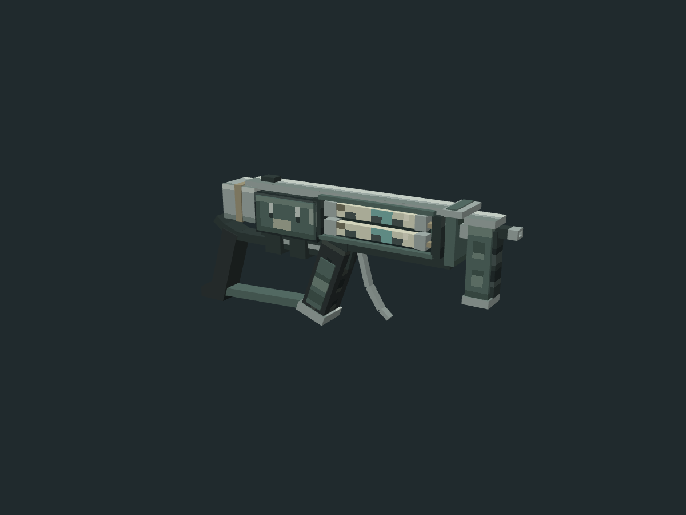

# 注射器枪 SyringeGun

制作来源：人工 + AI（TakaraMiyuki + GPT-6 / Codex）。

TakaraMiyuki 提供原作参考，手动修改本次最终几何、UV 和像素贴图；AI 完成初稿，本轮仅保留人工保存结果、整理贴图依赖、重出原生几何与预览并执行交付验证。工具为本机 Blockbench 5.2.2、Python / Pillow。更新日期：2026-11-14。

本次直接替换 `art/models/syringe_gun_20261113/` 原候选 A。仍为待评审资产，本地 curated 分类不代表评选通过；未接入游戏。



## 本轮变化与保留边界

- 相比初稿，62 cubes 更新为 64 cubes，仍为 7 bones；声明面由 372 更新为 384。几何比例、位置、局部结构、UV 与图案均采用用户保存版本。
- 有效贴图由 64×64 更新为人工调整的 128×128 RGBA；项目逻辑 UV 为 32×32。Blockbench 列表换算为 64x，不能据此断言每个面均严格遵循同一密度。
- 用户工程仍携带一张未被使用的旧 64×64 内嵌贴图。384 个面全部引用新的 128×128 贴图；交付时只移除未使用旧贴图，将有效槽位 1 映射为 0，清除跨项目相对路径并统一文件名。
- 64 个元素的名称、坐标、枢轴、旋转、逐面 UV 及朝向与人工快照严格一致；骨骼语义、层级一致。原生 codec 只清除了 `stock.primary_selected` 编辑器选中标记。
- 有效 PNG 的文件字节与人工快照完全一致，无重绘、缩放或重新排列 UV。`stock_butt_pad` 的部分面包含人工透明裁切，保留原 alpha 与 UV，没有为追求全不透明而修改。

原始人工保存文件及外置 PNG 位于 `reference/snapshot_before_publish/`；准备过程与保留证明见 `reference/user_revision_preparation.json`、`reference/human_preservation.json`。此次没有执行新的 UV 展开；未将原生重排往返标为通过。

## 交付文件

| 文件 | 内容 |
| --- | --- |
| `syringe_gun.bbmodel` | Blockbench Bedrock Entity 工程，内嵌当前唯一使用的 PNG，无外部路径依赖 |
| `syringe_gun.geo.json` | 原生导出，format 1.12.0，identifier `geometry.syringe_gun` |
| `syringe_gun_tex.png` | 128×128、RGBA、单帧；alpha 为 0 或 255，透明像素 RGB 为零 |
| `preview_front/back/side/oblique.png` | 四件套；另附顶视及后斜视两张 |
| `validation.json` | 当前贡献者、尺寸、成本、保留核对与交付检查 |
| `structure_audit.json`、`audit_cost.json` | 当前结构和成本检查 |
| `reference/` | 人工快照、调色板、原作参考、原生导出/渲染脚本与验证证据 |

## 原作依据和尺寸

原作查证来自本机 Barotrauma 安装内容，分别核对中英文条目：

- `Content/Texts/SimplifiedChinese/SimplifiedChineseVanilla.xml`：`entityname.syringegun` = 注射器枪。
- `Content/Texts/English/EnglishVanilla.xml`：`entityname.syringegun` = Syringe Gun。
- `Content/Items/Tools/tools.xml`：`Item identifier="syringegun"`，`scale="0.5"`，精灵 `Content/Items/Tools/tools.png`，裁切 `0,93,149,71`；物品栏图集裁切 `0,64,64,64`。
- 补充来源：[官方 Wiki · Syringe Gun](https://barotraumagame.com/wiki/Syringe_Gun)。用户参考图和原作裁切保存在 `reference/`。

原作裁切与 scale 不能直接换算现实米制尺寸。当前尺寸为作者人工修订结果，按 16 模型单位=1 格换算：约 **1.022529 × 0.413073 × 0.127500 格**（X×Y×Z），即 **16.36046 × 6.60917 × 2.04** 模型单位。含旋转包围盒在 `validation.json` 中复算。初稿约 0.99 m 的比例推定是历史设计依据，不用于覆盖本次人工尺寸。

编辑工程枪口沿 +X，Y 向上，Z 为厚度；Bedrock 原生 codec 镜像 X 并转换旋转语义，导出枪口沿 −X。几何的逻辑贴图尺寸为 32×32，外置 PNG 是 128×128；二者比例应保持，不能将 geo 的贴图尺寸擅自改为 128。

## 预览与验证

六张预览均由当前人工调整版在本机 Blockbench 5.2.2 原生 Preview / Three.js 中生成，1200×900，纯色 `#202a2d` 底，无 UI、网格及选中线。正/背/侧/顶为正交，前后斜视为透视；按当前包围盒居中取景，每个视角独立创建并释放离屏视图。参数在 `reference/render_conditions.json`，脚本为 `reference/render_native.js`。

已完成原生保存、关闭本任务工程、重新打开、重新导出；项目元素、骨骼、内嵌 PNG 和原生文本导出的 geo 均严格一致。人工源与交付的几何/UV/像素保留核对、UV 边界、透明像素、依赖完整性和结构审计通过。实际客户端、手持姿态、射击、动画及 FPS 未实测。

成本：64 cubes / 7 bones / 384 声明面；1 材质，128² 单帧贴图。基础 RGBA 字节量 65536（64 KiB），不是显存实测。所有人工构件保留；没有执行历史隐藏面清理来改变当前外观。

## 重现当前交付

当前 `.bbmodel` 是几何与 UV 的权威输入；初稿参数不能重建人工结果。需要 Python、Pillow、websocket-client，以及已安装 Blockbench 的隔离调试实例（本轮本机端口 9224）。脚本按自身所在资产目录解析路径，不依赖作者本机资产目录。

从仓库根可运行：

```text
python art/models/syringe_gun_20261113/reference/build_asset.py
python art/models/syringe_gun_20261113/reference/bb_native.py art/models/syringe_gun_20261113/reference/export_current.js
python art/models/syringe_gun_20261113/reference/bb_native.py art/models/syringe_gun_20261113/reference/render_native.js
python art/models/syringe_gun_20261113/reference/bb_native.py art/models/syringe_gun_20261113/reference/verify_reopen.js
python art/models/syringe_gun_20261113/reference/validate_asset.py
```

`build_asset.py` 仅从当前工程提取内嵌 PNG；`export_current.js` 要求隔离实例没有其他工程。人工原始快照经过 `prepare_user_revision.py` 可以重新生成本轮整理输入；不要在正在编辑的用户窗口运行。普通资产验证不启动 Minecraft。

`reference/authored_input.bbmodel`、`geometry_spec.json`、`face_cleanup*`、`select_invisible_faces.js`、`baseline_face_cleanup/`、`final_preview_check/`、`repeat_preview_check/` 及旧比较报告是初稿历史证据，**不描述当前人工版，也不是当前构建输入**。本轮实际证据为 `native_reopen_validation.json`、`human_preservation.json` 和根目录 `validation.json`。
